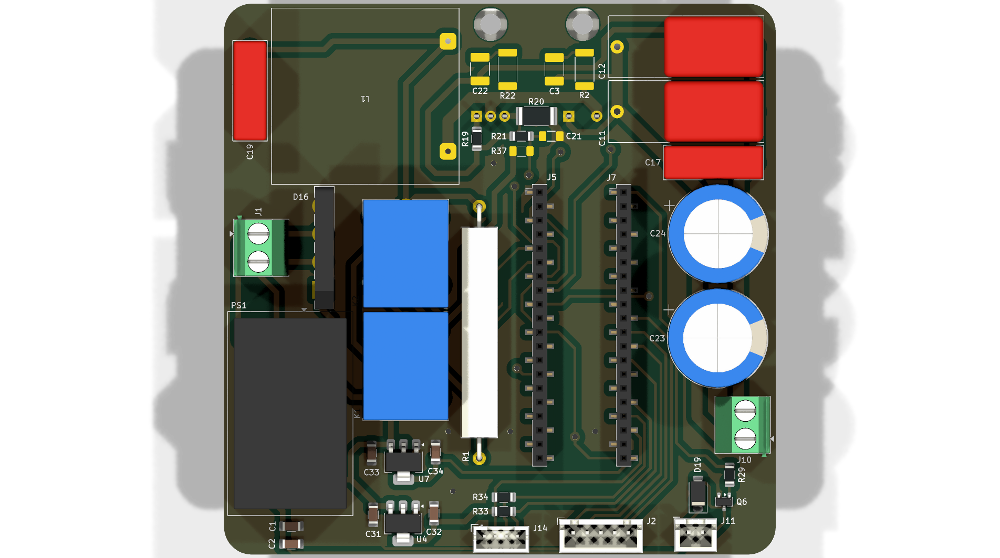
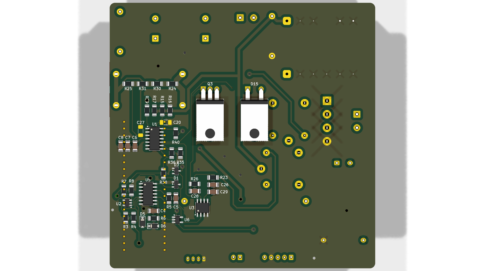
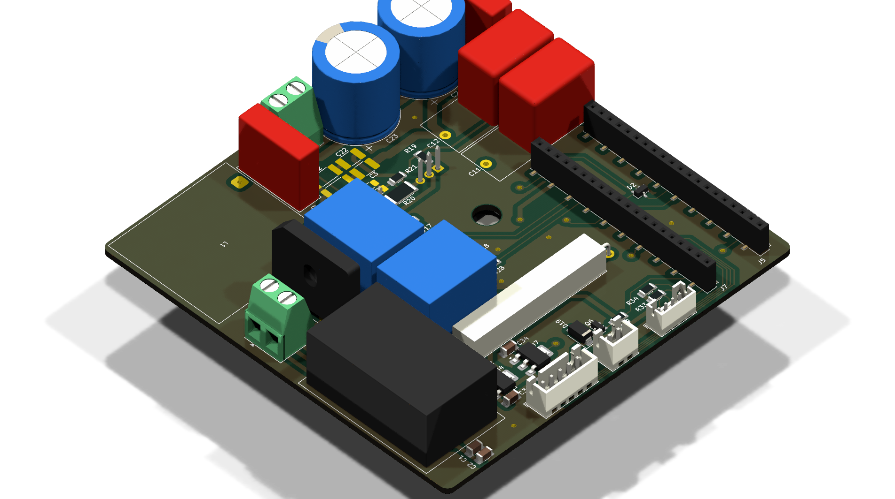
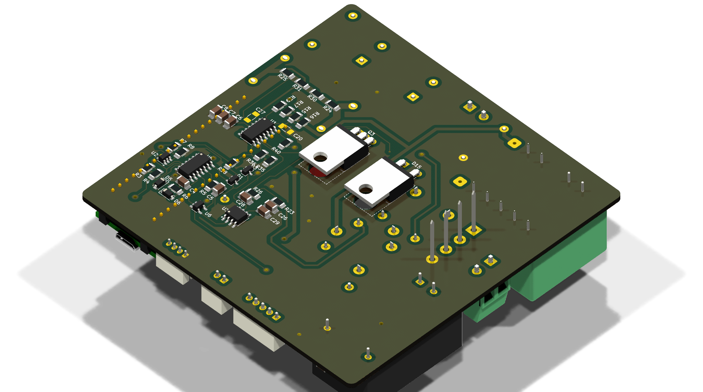
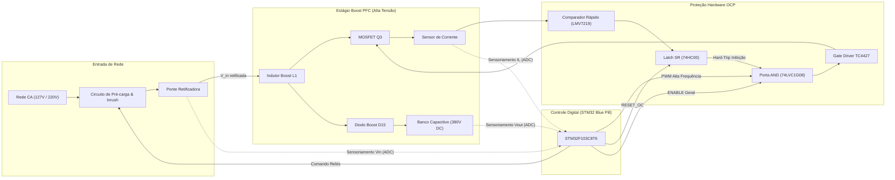

# ⚡ AC-DC 380V Active Boost PFC Converter


-red.svg)


-purple.svg)


Conversor estático de potência CA/CC com **Correção Ativa do Fator de Potência (Active PFC)** na topologia **Boost**, projetado para elevar a tensão da rede elétrica retificada (127V / 220V AC) para um barramento CC estabilizado de **380V DC**.

O controle digital de malha fechada (tensão e corrente em modo de condução contínua - CCM) e gerenciamento de estados é operado por uma plataforma **STM32F103C8T6 (ARM Cortex-M3 a 72 MHz)**, acompanhado de proteções ultrarrápidas de sobrecorrente por hardware e circuito inteligente de pré-carga (*soft-start / inrush current limiting*).

---

## 📸 Renderizações 3D do Projeto

| Vista Superior (Top View) | Vista Inferior (Bottom View) |
| :---: | :---: |
|  |  |

| Perspectiva Superior Isométrica | Perspectiva Inferior Isométrica |
| :---: | :---: |
|  |  |

---

## 🧭 1. Visão Geral da Arquitetura do Conversor

O sistema é dividido em três blocos funcionais modulares conforme o esquemático hierárquico:
1. **Low Frequency Rectifier & Inrush (`lf_rectifier`):** Ponte retificadora de entrada, relé de bypass de inrush (`RELAY_INRUSH`) e relé mestre de ligamento (`RELAY_ON_OFF`).
2. **Estágio de Potência & Proteção PFC (`pfc`):** Indutor boost, MOSFET de comutação rápida, diodo boost ultrarrápido, gate driver com porta de intertravamento e latch analógico de sobrecorrente em hardware.
3. **Placa de Controle & IHM (`mcu`):** Breakout STM32F103 (Blue Pill), conversores de nível lógico, display I2C, encoder rotativo e acionamento térmico do ventilador.



---

## 📊 2. Especificações Técnicas

| Parâmetro | Valor / Faixa | Observações |
| :--- | :--- | :--- |
| **Topologia** | Boost PFC Ativo (CCM) | Fator de Potência $> 0.98$ |
| **Tensão de Entrada ($V_{in}$)** | $127\text{ V}_{\text{RMS}} - 220\text{ V}_{\text{RMS}}$ ($60\text{ Hz}$) | Tensão de pico retificada: $\approx 180\text{ V} - 311\text{ V}$ |
| **Tensão de Saída ($V_{out}$)** | **$380\text{ V DC}$ regulada** | Tensão nominal do barramento CC |
| **Controlador** | STM32F103C8T6 (ARM Cortex-M3) | 72 MHz, 64 KB Flash, ADC 12 bits |
| **Chaveamento Principal** | MOSFET TO-220 + Diodo Boost TO-220 | Dissipadores dimensionados para convecção forçada |
| **Driver de Gate** | Microchip TC4427 + Intertravamento 74LVC1G08 | Resposta sub-microssegundo |
| **Proteção de Sobrecorrente (OCP)** | Comparador LMV7219 + Latch 74HC00 | Desligamento por hardware independente do MCU |
| **Pré-carga de Barramento** | Relés de 2 estágios (`INRUSH` e `ON_OFF`) | Protege diodos e banco capacitivo na energização |
| **Interface do Usuário** | Display I2C + Encoder Rotativo com Push-Button | Navegação de menus, leituras e parametrização |
| **Refrigeração** | Saída controlada de 12V para Ventoinha | Acionamento via transistor comutada por PWM/GPIO |

---

## 🔌 3. Pinout & Mapeamento do Microcontrolador (STM32 Blue Pill)

O mapeamento de pinos foi otimizado para conferir **máxima imunidade eletromagnética**, separando sinais analógicos de medição de ruídos digitais de chaveamento e garantindo roteamento direto para os conectores.

### Conector Esquerdo (`J7` - Lado do Driver, Relés e Interface)

| Pino Blue Pill | Sinal Associado | Função no Hardware | Descrição / Operação |
| :--- | :--- | :--- | :--- |
| **`PB12`** | `I2C_SCL` | I2C Clock (Software Bit-Bang) | Clock do barramento serial do display |
| **`PB13`** | `I2C_SDA` | I2C Data (Software Bit-Bang) | Dados do barramento serial do display |
| **`PB14`** | `FAN_ON_OFF` | GPIO Output | Comando do transistor de controle do ventilador |
| **`PB15`** | `ENC_ENABLE` | GPIO | Pino 5 do conector frontal do painel / Encoder (`J2`) |
| **`PA8`** | `ENC_BUTTON`| GPIO Input (Pull-up) | Botão de seleção/clique do encoder rotativo |
| **`PA9`** | `ENC_B` | GPIO Input / EXTI | Canal B de quadratura do encoder rotativo |
| **`PA10`** | `ENC_A` | GPIO Input / EXTI | Canal A de quadratura do encoder rotativo |
| **`PA11`** | `PFC_PWM` | `TIM1_CH4` (PWM Timer 1) | Sinal modulado em largura de pulso de alta frequência |
| **`PA12`** | `RESET_OC` | GPIO Output (Open-Drain/PP) | Pulso de reset para destravar o latch de sobrecorrente |
| **`PB5`** | `ENABLE` | GPIO Output | Sinal mestre de habilitação de gate drive (para U6) |
| **`PB7`** | `RELAY_INRUSH`| GPIO Output | Aciona o relé de limitação de corrente de partida |
| **`PB8`** | `RELAY_ON_OFF`| GPIO Output | Aciona o relé principal de energização da rede |

### Conector Direito (`J5` - Lado Exclusivo de Sensoriamento Analógico)

| Pino Blue Pill | Sinal Associado | Função no Hardware | Descrição / Operação |
| :--- | :--- | :--- | :--- |
| **`PB1` / `PA6`**| `PFC_VIN` | `ADC12_IN9` / `ADC12_IN6` | Sensoriamento da tensão senoidal retificada de entrada |
| **`PB0` / `PA5`**| `PFC_VOUT`| `ADC12_IN8` / `ADC12_IN5` | Sensoriamento da alta tensão de saída estabilizada (380V) |
| **`PA7`** | `PFC_IL` | `ADC12_IN7` | Sensoriamento analógico da corrente no indutor boost |
| **`PA0` - `PA4`**| *Reservados* | `ADC12_IN0` a `ADC12_IN4` | Entradas analógicas livres para telemetria/sensores de temp. |
| **`PC13`** | *LED Onboard* | GPIO Output | LED indicador de batimento de coração (*heartbeat*) |

---

## 🛡️ 4. Circuitos de Proteção e Segurança em Hardware

1. **Proteção Ultrarrápida de Sobrecorrente (Hardware Trip):**
   * Em conversores boost, sobrecorrentes na chave podem queimar semicondutores em microssegundos.
   * O sinal do resistor shunt de corrente é monitorado continuamente pelo comparador analógico **LMV7219** (`U2`).
   * A saída do comparador aciona imediatamente um **Latch SR implementado com portas NAND 74HC00** (`U5`), travando a saída em nível lógico baixo e cortando a porta AND `74LVC1G08` (`U6`) antes mesmo do firmware do MCU tomar conhecimento.
   * O destravamento após mitigação só ocorre mediante pulso explícito do pino `RESET_OC`.

2. **Sequenciamento de Energização e Pré-Carga:**
   * Na energização inicial, o relé `RELAY_INRUSH` comuta o fluxo de corrente por resistores limitadores de alta potência até os capacitores de saída carregarem sem picos destrutivos.
   * Ao atingir o patamar nominal de entrada, o relé mestre `RELAY_ON_OFF` fecha o circuito em paralelo e o conversor pode ser habilitado com segurança.

---

## 📁 5. Estrutura do Repositório

```text
├── power-supply.kicad_pro      # Arquivo de gerenciamento do projeto KiCad 10
├── power-supply.kicad_sch      # Esquemático principal (Top-Level Sheet)
├── power-supply.kicad_pcb      # Layout e roteamento completo da placa de circuito impresso
├── lf_rectifier.kicad_sch      # Sub-folha: Retificação de baixa frequência e inrush
├── pfc.kicad_sch               # Sub-folha: Estágio Boost PFC de 380V e circuitos de proteção
├── mcu.kicad_sch               # Sub-folha: Módulo MCU Blue Pill e conexões de IHM
├── docs/
│   └── PFC_380V_Schematic.pdf  # Esquemático completo exportado em PDF vetorial
├── renders/                    # Renders 3D fotorrealistas em alta resolução
│   ├── render_top.png
│   ├── render_bottom.png
│   ├── render_iso_top.png
│   └── render_iso_bottom.png
├── .gitignore                  # Filtro para temporários, caches e arquivos de backup KiCad
├── LICENSE                     # Licença de Hardware Aberto CERN-OHL-S v2
└── README.md                   # Documentação técnica de engenharia
```

---

## 🚀 6. Como Abrir e Validar o Projeto

### Pré-requisitos
* **KiCad EDA 10.0+** instalado no sistema.

### Regenerar Renderizações 3D (via Linha de Comando)
```bash
kicad-cli pcb render -o renders/render_top.png --width 1920 --height 1080 --side top --quality high power-supply.kicad_pcb
kicad-cli pcb render -o renders/render_bottom.png --width 1920 --height 1080 --side bottom --quality high power-supply.kicad_pcb
kicad-cli pcb render -o renders/render_iso_top.png --width 1920 --height 1080 --rotate -45,0,45 --quality high power-supply.kicad_pcb
kicad-cli pcb render -o renders/render_iso_bottom.png --width 1920 --height 1080 --side bottom --rotate -45,0,45 --quality high power-supply.kicad_pcb
```

### Exportar Esquemático em PDF
```bash
kicad-cli sch export pdf -o docs/PFC_380V_Schematic.pdf power-supply.kicad_sch
```

---

## 📜 7. Licença & Créditos

Projeto desenvolvido por **Gabriel Diniz**.  
Distribuído sob a licença **CERN-OHL-S v2** (*CERN Open Hardware Licence Strongly Reciprocal*). Consulte o arquivo [LICENSE](LICENSE) para mais detalhes.
