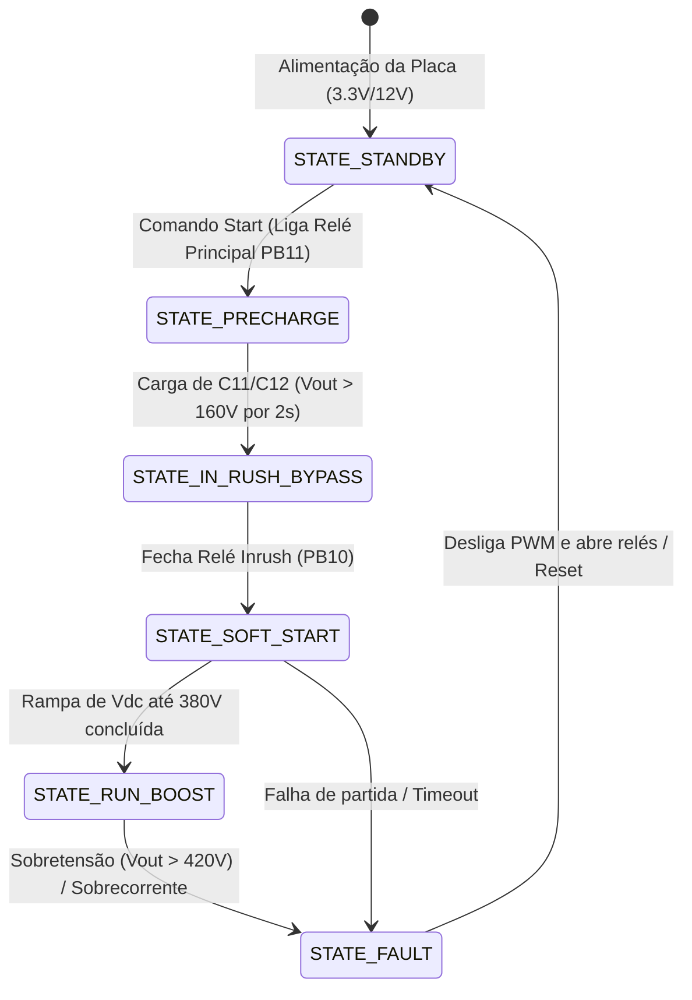

# Firmware - Active Boost PFC (STM32F103C8T6)

Diretório destinado ao firmware embarcado do conversor Boost PFC operando com controle digital em tempo real.

---

## 1. Visão Geral da Plataforma

- **Microcontrolador**: STM32F103C8T6 (Blue Pill)
- **Núcleo**: ARM® 32-bit Cortex®-M3 @ 72 MHz
- **Memória**: 64 KB Flash, 20 KB SRAM
- **Ambiente de Desenvolvimento Homologado**: **STM32CubeIDE v1.19** *(requisito de versão especificado pela orientação; versões mais recentes apresentam instabilidades na geração de projetos para a família F1)*.
- **Ferramenta de Gravação/Debug**: ST-Link V2 via protocolo SWD (Serial Wire Debug).

---

## 2. Mapeamento de Pinos de Hardware (Hardware Pinout)

O mapeamento abaixo reflete exatamente as conexões estabelecidas na folha esquemática [`hardware/mcu.kicad_sch`](file:///hardware/mcu.kicad_sch) e roteadas na placa [`hardware/power-supply.kicad_pcb`](file:///hardware/power-supply.kicad_pcb):

| Pino MCU | Sinal do Projeto | Periférico STM32 | Modo / Função | Descrição |
| :--- | :--- | :--- | :--- | :--- |
| **PA2** | `PFC_PWM` | `TIM2_CH3` | PWM Output | Sinal de comutação do MOSFET de potência (50 kHz a 100 kHz) via gate driver |
| **PA7** | `PFC_IL` | `ADC1_IN7` | ADC Analog In | Leitura analógica da corrente do indutor $i_L$ (saída do amplificador de shunt) |
| **PB0** | `PFC_VOUT` | `ADC1_IN8` | ADC Analog In | Leitura analógica da tensão de saída do barramento CC (divisor resistivo 380V) |
| **PB1** | `PFC_VIN` | `ADC1_IN9` | ADC Analog In | Leitura analógica da tensão retificada de entrada (divisor resistivo da rede) |
| **PB10** | `RELAY_INRUSH` | `GPIO_Output` | Push-Pull | Acionamento do relé de bypass do resistor NTC de inrush (após pré-carga) |
| **PB11** | `RELAY_ON_OFF` | `GPIO_Output` | Push-Pull | Relé principal de conexão da alimentação CA |
| **PB12** | `FAN_CTRL` | `GPIO_Output` | Push-Pull | Acionamento do cooler/ventoinha de arrefecimento dos dissipadores |
| **PB8** | `I2C1_SCL` | `I2C1` | Open-Drain (Ext Pull-Up 4.7k) | Clock do barramento I2C (Display OLED 0.96" SSD1306) |
| **PB9** | `I2C1_SDA` | `I2C1` | Open-Drain (Ext Pull-Up 4.7k) | Dados do barramento I2C (Display OLED 0.96" SSD1306) |
| **PB3** | `EXP_SCK` | `SPI1_SCK` / GPIO | Alternate / Push-Pull | Barramento de expansão / interface de usuário J2 |
| **PB4** | `EXP_MISO` | `SPI1_MISO` / GPIO | Input | Barramento de expansão / interface de usuário J2 |
| **PB5** | `EXP_MOSI` | `SPI1_MOSI` / GPIO | Alternate / Push-Pull | Barramento de expansão / interface de usuário J2 |
| **PA15** | `EXP_CS` | `GPIO_Output` | Push-Pull | Chip select do conector de expansão J2 |
| **PA13** | `SWDIO` | `SYS_JTMS-SWDIO` | SWD Debug | Pino de dados para gravação e debug ST-Link |
| **PA14** | `SWCLK` | `SYS_JTCK-SWCLK` | SWD Debug | Pino de clock para gravação e debug ST-Link |

---

## 3. Passo a Passo para Criar o Projeto no STM32CubeIDE 1.19

Ao iniciar a criação do projeto de firmware no ambiente:

1. **Abrir o STM32CubeIDE 1.19**:
   - Vá em `File` $\rightarrow$ `New` $\rightarrow$ `STM32 Project`.
2. **Seleção do Microcontrolador**:
   - Selecione a aba **MCU/MPU Selector**.
   - No campo de busca, digite: `STM32F103C8Tx` (LQFP48).
   - Clique em **Next**.
3. **Configuração do Projeto**:
   - **Project Name**: `pfc_boost_firmware`
   - **Location**: Selecionar a pasta `firmware/` do repositório.
   - **Target Language**: `C`
   - **Target Binary Type**: `Executable`
   - **Target Project Type**: `STM32Cube`
   - Clique em **Finish**.
4. **Configurações no Arquivo `.ioc` (CubeMX)**:
   - **System Core / RCC**:
     - High Speed Clock (HSE): *Crystal/Ceramic Resonator* (8 MHz externo).
   - **Clock Configuration**:
     - Configurar PLLSource = HSE (8 MHz), PLLMul = `x9` $\rightarrow$ SYSCLK = **72 MHz**.
     - AHB Prescaler = `1`, APB1 Prescaler = `/2` (36 MHz máx, Timers = 72 MHz), APB2 Prescaler = `1` (72 MHz).
     - ADC Prescaler = `/6` (12 MHz $\le$ 14 MHz máx permitido pela ST).
   - **Timers / TIM2**:
     - Channel 3: *PWM Generation CH3*.
     - Prescaler = `0`, ARR = `1439` (para switching de $72\text{ MHz} / 1440 = 50\text{ kHz}$) ou ARR = `719` ($100\text{ kHz}$).
     - Trigger Event Selection (TRGO): *Update Event* (usado para disparar o ADC de forma síncrona no vale ou no topo do dente de serra).
   - **Analog / ADC1**:
     - Ativar canais `IN7`, `IN8`, `IN9` em modo Scan.
     - DMA Continuous Requests habilitado via DMA1 Canal 1 em modo Circular.
   - **Connectivity / I2C1**:
     - Modo `I2C`, Standard Mode (100 kHz) ou Fast Mode (400 kHz).

---

## 4. Arquitetura Modular Recomendada

Para manter o código desacoplado dos drivers gerados pelo CubeMX e permitir testes unitários e portabilidade dos algoritmos de controle, recomenda-se a seguinte estrutura:

```
firmware/
├── .ioc                          # Arquivo de configuração de pinos e relógio do CubeMX
├── Core/                         # Código gerado pelo CubeMX (Drivers HAL, main.c, stm32f1xx_it.c)
├── Drivers/                      # HAL STM32F1xx e CMSIS
└── App/                          # Aplicação e Algoritmos de Controle (Código do Usuário)
    ├── bsp/                      # Abstração de hardware da placa (relés, LEDs, leitura ADC calibrada)
    ├── control/                  # Algoritmo de controle digital (Cascata Energia/Jacobiano, Anti-windup)
    │   ├── pfc_control.h
    │   ├── pfc_control.c
    │   └── pfc_params.h
    ├── fsm/                      # Máquina de estados finita do conversor (Início, Carga, Operação, Falha)
    │   ├── pfc_fsm.h
    │   └── pfc_fsm.c
    ├── protection/               # Proteções ativas (OVP, UVP, OCP, Falha de Sensor)
    └── ui/                       # Driver do display OLED SSD1306 e interface serial/telemetria
```

---

## 5. Máquina de Estados Finita (FSM) do Conversor

O firmware opera segundo os seguintes estados operacionais protegidos:



---

## 6. Algoritmo de Controle

O modelo de controle implementado no firmware baseia-se nos cálculos validados na simulação contida em [`simulation/simulate_pfc_control.py`](file:///simulation/simulate_pfc_control.py):
- **Malha Interna de Corrente**: Taxa de amostragem de 50 kHz a 100 kHz (executada na interrupção de conversão do ADC sincronizada com o PWM).
- **Malha Externa de Tensão/Energia**: Executada em taxa decrescida (1 kHz a 5 kHz), sintetizando a condutância $g(k)$ para garantir alto fator de potência e baixa distorção harmônica (THD).
